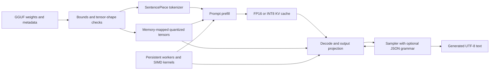

# PicoLM Edge

PicoLM Edge is a pure C11 inference engine for Raspberry Pi and Windows. It accepts Llama GGUF models with Llama SentencePiece tokenization and unscaled, full-head RoPE. The engine is derived from RightNow-AI/picolm at `cf3f2dfca389e4f19a10dd36ce110c41ea12c899` and distributed under MIT. [Upstream revision](https://github.com/RightNow-AI/picolm/tree/cf3f2dfca389e4f19a10dd36ce110c41ea12c899) · [License](LICENSE) · [简体中文](README.zh.md)

## Build and run

On Windows, put MinGW-w64 GCC and GNU Make on `PATH` and run from the project root. The executable links the compiler runtime statically.

```powershell
mingw32-make -j4 native
.\picolm_opt.exe datasets/tinyllama-1.1b-chat-v1.0.Q4_K_M.gguf -p "The capital of France is" -n 16 -t 0 -j 4
```

| Platform | Command | Executable |
| --- | --- | --- |
| Windows x86-64 with AVX2 and FMA | `mingw32-make native` | `picolm_opt.exe` |
| Raspberry Pi 3/4/5, 64-bit Raspberry Pi OS | `make pi` | `picolm_pi` |
| Raspberry Pi 5, 64-bit Raspberry Pi OS | `make pi5` | `picolm_pi5` |
| Raspberry Pi 32-bit hard-float | `make pi-arm32 ARM32_CC=gcc` with an ARMv6-compatible Raspberry Pi OS sysroot | `picolm_pi_arm32` |
| AArch64 Linux cross-build from another host | `make cross-pi` with `aarch64-linux-gnu-gcc` on `PATH` | `picolm_cross_pi` |
| Scalar comparison | `make scalar` or `mingw32-make scalar` | `picolm_scalar` or `picolm_scalar.exe` |

```bash
make pi
./picolm_pi datasets/stories15M-q4_0.gguf -p "Once upon a time" -n 32 -t 0 -j 4
```

On Windows, CLI arguments are converted from UTF-16 to UTF-8 and model paths are opened with `CreateFileW`. The benchmark uses relative paths for both executables.

## Inference and evaluation



- `-p` accepts a prompt. UTF-8 stdin also works. `-n` keeps the upstream generation budget convention, which includes sampling from the last prompt token before the decode steps. `-t 0` enables greedy sampling. `-k` sets top-p, `-s` sets the seed, `-c` caps context and `-j` sets the thread count.
- `--kv-quant fp16|int8` selects the cache representation. INT8 stores one FP16 scale per head and position for each of K and V. `--cache FILE` writes KVCP v3 and reuses cached positions when the SHA-256 digests of the model and the token prefix match and the active context and KV representation are compatible. It verifies the payload digest during loading. POSIX writes use private files. A v1 or v2 cache triggers fresh prefill by default. Use `--trust-legacy-cache` to import a v1 or v2 file whose model and prompt you have verified. The next save upgrades it to v3.
- `--json` emits one complete JSON value on success. A run that reaches the token budget can append deterministic closing bytes to a valid prefix. `json_suffix_bytes` counts those bytes and `finish_reason` records how generation ended. If the model provides no finite logits or the grammar admits no token, the command exits with an error. Field names, types and values come from the prompt and model.
- `--top-k N` and `--min-p P` opt into pre-filtering. The default uses temperature and nucleus sampling. `--no-threadpool` uses transient workers for comparison.
- `--bench` writes a JSON record to stderr with token IDs, prefill/decode rates, TTFT, peak RSS and KV allocation. Standard output carries generated text. `--ppl FILE` writes perplexity and mean NLL to stdout using full-vocabulary log-sum-exp. When the available context fills, scoring resumes at the boundary with a fresh context.

```powershell
.\picolm_opt.exe datasets/stories15M-q8_0.gguf -p "Once upon a time" -n 32 -t 0 -j 4 --kv-quant int8 --bench
.\picolm_opt.exe datasets/tinyllama-1.1b-chat-v1.0.Q4_K_M.gguf -j 4 --ppl datasets/wikitext2_eval.txt
```

## Verification

```powershell
mingw32-make -j4 native scalar
mingw32-make -j4 test
python scripts/run_benchmarks.py
```

The C tests generate a small GGUF locally and exercise independent GGML wire-format vectors, SIMD, thread-pool dispatch, JSON grammar, tokenizer, sampler and binary parsers. Checks also run with `-DNDEBUG`. Make records the successful compiler invocation beside each output and rebuilds when the invocation changes.

Benchmarks use the local TinyLlama, Stories15M, WikiText-2 and JSONSchemaBench files. `--repeats N` controls throughput repetitions. `--reuse-json` reuses syntax runs with matching hashes. `--ppl-timeout SECONDS` sets a timeout for each perplexity run. The suite checks the benchmark binaries and inputs before and after each full run. The report links build evidence when its manifest matches the benchmark binaries and log.

## Measured results

TinyLlama-1.1B Q4_K_M on a Windows i5-1240P (1 run per configuration, in tokens/s; baseline TTFT from upstream prefill log):

| Prompt tokens | Threads | Prefill, baseline → optimized | Decode, baseline → optimized | TTFT, baseline → optimized (ms) |
| ---: | ---: | ---: | ---: | ---: |
| 32 | 1 | 2.00 → 9.99 (4.99×) | 2.10 → 10.35 (4.93×) | 16020 → 3204.4 |
| 32 | 4 | 5.30 → 27.96 (5.28×) | 5.70 → 24.85 (4.36×) | 6020 → 1144.5 |
| 128 | 1 | 2.00 → 10.59 (5.29×) | 2.10 → 9.99 (4.76×) | 64520 → 12091.0 |
| 128 | 4 | 5.00 → 29.33 (5.87×) | 4.90 → 27.52 (5.62×) | 25580 → 4363.9 |

- **Greedy equivalence**: All four TinyLlama greedy runs matched the upstream token IDs and baseline text after line-ending normalization.
- **INT8 KV cache (`128` tokens, `4` threads)**: KV allocation dropped **48.44%** (`44.000 MiB → 22.688 MiB`, peak RSS `613.922 → 612.551 MiB`); WikiText-2 perplexity (`768` UTF-8 bytes, `201` scored tokens) moved from `30.0924` (FP16) to `30.0720` (INT8), `Δ = -0.0204`.
- **Persistent thread pool (`32` tokens, `4` threads, vs. transient threads)**: Prefill `18.61 → 27.96` token/s, Decode `18.90 → 24.85` token/s, TTFT `1719.5 → 1144.5 ms`.
- **Stories15M Q4_0 / Q8_0 (4 threads, median of 3, SIMD vs. scalar)**: Decode speed improved `336.07 → 1113.29` token/s (**3.31×**) and `340.04 → 1419.07` token/s (**4.17×**) with identical greedy token IDs (fixing upstream MHA `n_kv_heads=0` divide-by-zero).
- **Long-prompt BPE heap (`32 KiB` prompt, median of 3)**: End-to-end latency reduced from `3139.2 ms → 22.5 ms` (**139.5×**).
- **JSON grammar & binary hardening**: Valid JSON on 50 local JSONSchemaBench prompts rose from `10/50 → 50/50` (`47/50` valid objects, `30` with deterministic closing suffix); `24` malformed GGUF and `18` malformed KVCP files were rejected cleanly (`0` crashes).
- **ARM & POSIX builds**: `pi`, `pi5`, `cross-pi`, `pi-arm32` ELF binaries and POSIX C11 test targets compiled with `-Werror` (`0` warnings); physical Raspberry Pi hardware execution remains pending on-device verification.

The Windows measurements use the same prompts and flags for each baseline comparison. See the [Chinese benchmark report](reports/benchmark_report.md), [verification log](reports/verification.log), and [machine-readable results](reports/benchmark_summary.json).
