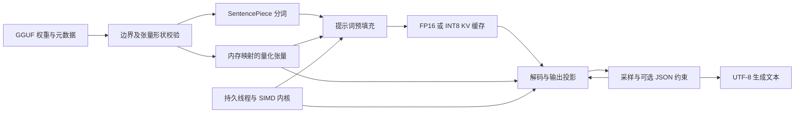

# PicoLM Edge

PicoLM Edge 是面向 Raspberry Pi 和 Windows 的纯 C11 推理引擎，支持使用 Llama SentencePiece 分词和无缩放全头 RoPE 的 Llama GGUF 模型。项目基于 RightNow-AI/picolm 的 `cf3f2dfca389e4f19a10dd36ce110c41ea12c899` 版本，采用 MIT 许可证。 [上游版本](https://github.com/RightNow-AI/picolm/tree/cf3f2dfca389e4f19a10dd36ce110c41ea12c899) · [许可证](LICENSE) · [English](README.md)

## 构建与运行

Windows 环境将 MinGW-w64 GCC 和 GNU Make 加入当前会话的 `PATH`，然后在项目根目录执行。Windows 二进制静态链接编译器运行时。

```powershell
mingw32-make -j4 native
.\picolm_opt.exe datasets/tinyllama-1.1b-chat-v1.0.Q4_K_M.gguf -p "The capital of France is" -n 16 -t 0 -j 4
```

| 平台 | 命令 | 产物 |
| --- | --- | --- |
| Windows x86-64，支持 AVX2 与 FMA | `mingw32-make native` | `picolm_opt.exe` |
| Raspberry Pi 3/4/5，64 位系统 | `make pi` | `picolm_pi` |
| Raspberry Pi 5，64 位系统 | `make pi5` | `picolm_pi5` |
| Raspberry Pi 32 位硬浮点 | 使用兼容 ARMv6 的 Raspberry Pi OS sysroot 执行 `make pi-arm32 ARM32_CC=gcc` | `picolm_pi_arm32` |
| 从其他主机交叉构建 AArch64 Linux | 将 `aarch64-linux-gnu-gcc` 加入 `PATH` 并执行 `make cross-pi` | `picolm_cross_pi` |
| 标量对照 | `make scalar` 或 `mingw32-make scalar` | `picolm_scalar` 或 `picolm_scalar.exe` |

```bash
make pi
./picolm_pi datasets/stories15M-q4_0.gguf -p "Once upon a time" -n 32 -t 0 -j 4
```

Windows 将命令行参数从 UTF-16 转为 UTF-8，再通过 `CreateFileW` 打开模型文件。基准脚本给两个可执行文件传入相同的相对路径。

## 推理流程



- `-p` 接收提示词，也可从标准输入读取 UTF-8。`-n` 沿用上游计数，先从最后一个提示 token 采样，再运行解码步。`-t 0` 启用贪心采样，`-k` 设定 top-p，`-s` 设定随机种子，`-c` 限制上下文，`-j` 设定线程数。
- `--kv-quant fp16|int8` 选择缓存类型。INT8 对 K 和 V 各按注意力头及位置保存一个 FP16 尺度。`--cache FILE` 写入 KVCP v3。模型内容和实际 token 前缀的 SHA-256 一致，且上下文和 KV 类型兼容时，才复用缓存。读取时核对载荷哈希，POSIX 写入使用私有文件。v1 和 v2 默认重新预填充。确认旧缓存对应当前模型和提示后，可用 `--trust-legacy-cache` 导入，下次保存会升级为 v3。
- `--json` 成功时输出一个语法完整的 JSON 值。耗尽 token 预算时，可以为有效前缀添加确定性的闭合字节。`json_suffix_bytes` 记录补全的字节数，`finish_reason` 记录结束原因。模型未给出有限分值，或语法约束下没有候选 token 时，命令报错退出。字段名、类型和值取决于提示词和模型。
- `--top-k N` 和 `--min-p P` 启用候选预筛选。默认使用温度与核采样。`--no-threadpool` 用于切换到临时线程对照。
- `--bench` 将 token ID、预填充与生成速度、TTFT、进程峰值 RSS、KV 分配量等指标写到标准错误流。标准输出提供生成文本。`--ppl FILE` 在标准输出提供困惑度及平均 NLL，使用全词表的 log-sum-exp。上下文满后从边界重置缓存并继续评分。

```powershell
.\picolm_opt.exe datasets/stories15M-q8_0.gguf -p "Once upon a time" -n 32 -t 0 -j 4 --kv-quant int8 --bench
.\picolm_opt.exe datasets/tinyllama-1.1b-chat-v1.0.Q4_K_M.gguf -j 4 --ppl datasets/wikitext2_eval.txt
```

## 测试与基准

```powershell
mingw32-make -j4 native scalar
mingw32-make -j4 test
python scripts/run_benchmarks.py
```

C 测试会在本地生成微型 GGUF，覆盖独立 GGML 格式向量、SIMD、线程池、JSON 约束、分词、采样及二进制解析。`-DNDEBUG` 下测试也会执行和判错。Make 为每个产物记录最近一次成功的编译命令，命令变化时触发重建。

基准脚本使用本地的 TinyLlama、Stories15M、WikiText-2 和 JSONSchemaBench 文件。`--repeats N` 指定性能测量次数，`--reuse-json` 在二进制与输入哈希一致时复用语法测试，`--ppl-timeout SECONDS` 指定每次困惑度评测的超时。完整基准在运行前后核对二进制和输入哈希，验收记录与参测版本匹配时才会关联构建日志。

## 实测结果

TinyLlama-1.1B Q4_K_M 在 Windows i5-1240P 上的实测速度（每组运行 1 次，单位为 token/s；基线 TTFT 取自上游预填充日志）：

| 提示 token | 线程 | 预填充，基线 → 优化 | 生成，基线 → 优化 | TTFT，基线 → 优化 (ms) |
| ---: | ---: | ---: | ---: | ---: |
| 32 | 1 | 2.00 → 9.99 (4.99×) | 2.10 → 10.35 (4.93×) | 16020 → 3204.4 |
| 32 | 4 | 5.30 → 27.96 (5.28×) | 5.70 → 24.85 (4.36×) | 6020 → 1144.5 |
| 128 | 1 | 2.00 → 10.59 (5.29×) | 2.10 → 9.99 (4.76×) | 64520 → 12091.0 |
| 128 | 4 | 5.00 → 29.33 (5.87×) | 4.90 → 27.52 (5.62×) | 25580 → 4363.9 |

- **贪心等价性**：四组 TinyLlama 贪心生成的 token ID 均与上游采样打点结果一致，规范化换行后的文本也与原始基线一致。
- **INT8 KV 缓存（128 token、4 线程）**：KV 分配量下降 **48.44%**（`44.000 MiB → 22.688 MiB`，峰值 RSS `613.922 → 612.551 MiB`）；WikiText-2 困惑度（`768` UTF-8 字节、`201` 个评分 token）由 `30.0924`（FP16）变为 `30.0720`（INT8），差值 `Δ = -0.0204`。
- **持久线程池（32 token、4 线程，对照临时线程）**：预填充 `18.61 → 27.96` token/s，生成 `18.90 → 24.85` token/s，TTFT `1719.5 → 1144.5 ms`。
- **Stories15M Q4_0 / Q8_0（4 线程、3 次中位数，SIMD 对照标量）**：生成速率分别提升 `336.07 → 1113.29` token/s（**3.31×**）与 `340.04 → 1419.07` token/s（**4.17×**），token ID 完全一致（同步修复原版 MHA `n_kv_heads=0` 除零崩溃）。
- **长提示词 BPE 合并堆（`32 KiB` 提示、3 次中位数）**：端到端耗时由 `3139.2 ms → 22.5 ms`（**139.5×**）。
- **JSON 语法与二进制安全加固**：50 条 JSONSchemaBench 提示的可解析 JSON 由 `10/50 → 50/50`（完整对象 `47/50`，其中 `30` 条使用确定性闭合后缀）；`24` 个畸形 GGUF 与 `18` 个畸形 KVCP 均被干净拒绝（`0` 崩溃）。
- **ARM 与 POSIX 交叉构建校验**：`pi`、`pi5`、`cross-pi`、`pi-arm32` ELF 产物及 POSIX C11 测试目标均在 `-Werror` 下 `0` 警告编过；物理树莓派实机运行性能尚待上板实测。

Windows 对照使用相同提示词与参数。完整过程和逐例数据见 [中文基准报告](reports/benchmark_report.md) · [构建与测试日志](reports/verification.log) · [机器可读结果](reports/benchmark_summary.json)。
